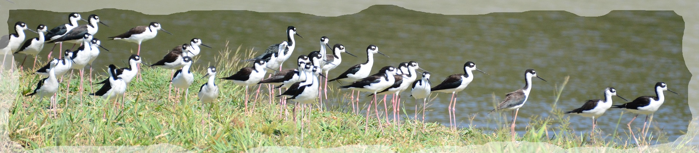

Please find on this page information regarding ASAB and/or the University of Portsmouth policy on code of conduct, equality, families, accessibility, and social media.

# Code of conduct

The ASAB conference is intended to be an inclusive, safe, and productive event where everyone feels welcome and able to participate. We are committed to creating a respectful and supportive environment for all attendees. To help us achieve this, we expect all participants of the conference to adhere to the *ASAB Conference Code of Conduct* outlined below and ask everyone attending the conference to contribute to a welcoming and respectful atmosphere. Where necessary, we reserve the right to ask any delegates who do not adhere to these expectations to leave the meeting.

## Acceptable Behaviour

We ask all conference delegates to:
-	Treat all conference participants with respect, courtesy, and consideration.
-	Respect and value the diversity of opinions, perspectives, and experiences represented at the conference.
-	Critique ideas, rather than individuals, and avoid personal attacks or criticism of other delegates.
-	Request permission from the conference organiser and the speaker before video / audio recording any presentation, discussion or other conference activity.
-	Presenters may request that their presentation is not shared on social media, and all attendees must respect this request.
-	Be mindful of others’ opportunities to contribute, particularly during discussions, and ensure that everyone has a reasonable opportunity to speak.

## Unacceptable Behaviour

The following behaviours are not acceptable:
- Sending abusive, threatening, or offensive messages to any conference delegates, organisers, exhibitors, or any other meeting guests.
- Bullying, harassment, or intimidation. We operate a zero-tolerance policy towards such behaviours. This includes, but is not limited to, derogative o discriminatory comments relating to any protected categories, such as ethnicity, gender identity, sexual orientation, or disability.
- Disrupting any aspect of the meeting, including interrupting speakers, presenters, or other participants.
- Sexual harassment, unwanted sexual attention, or the sharing of sexually inappropriate or otherwise offensive images or material.

## For delegates experiencing unacceptable behaviour

If you experience behaviour that you believe breaches our Code of Conduct, please contact the conference organisers or one of the conference moderators. Conference organisers and moderators will be clearly identified by badges on the conference website. 

If you would prefer to report an incident confidentially, you can contact the Meetings Secretary by email: 
Dr Vivek Nityananda - meetings[@]asab.org  

## Consequences
Conference organisers and moderators will address reports of behaviour that breaches the conference Code of Conduct and may contact individuals who do not meet these expectations. We reserve the right to ask any delegate who breaches the Code of Conduct to leave the meeting. In serious or repeated cases, this may also include prohibiting attendance at future conferences. 

# Family 
ASAB awards Childcare Grants of up to £500. <a href="(https://www.asab.org/childcare)">Click here for more information about ASAB childcare grants.</a> The awards are designed to provide a flexible contribution towards the additional costs of conference attendance faced by members with young children. 

The University of Portsmouth allows baby-wearing in all areas and welcomes children under supervision (Please see Portsmouth University’s Health and Safety policy regarding children and young persons xxxxx). The university supports breastfeeding in any part of any building, so mothers can feel free to feed their child wherever suits them. Comfortable nursing spaces with baby-changing facilities are also available in xxxxx (check this)

Attendees are invited to provide details of children and/or care-givers attending by email to the organising committee. A member of the organising committee may then contact you to seek further information.

# Equality 
As a small conference event we seek to ensure an environment of mutual concern and respect for all individuals. We strive to achieve appropriate representation of women, men, and non-binary people in line with the gender balance in our research community in all aspects of the ASAB Conference.

# Accessibility 
The conference venues are xxxxx (check this). Attendees are invited to give accessibility or disability information in advance through the registration form. They may be contacted by a member of the organising committee to discuss support arrangements to ensure that all attendees find it equally easy to participate fully in the meeting.

Do:
- Follow the ASAB 2027 Spring Conference on Social Media (BlueSky!) and tweet using #ASABSpring2027
- Tweet (or communicate on other social media) about what you are hearing and learning at #ASABSpring2027, but refrain from sharing when the speaker explicitly requests you do so. Presentations (talks/posters) are shareable by default, but speakers can request that the presentation, or specific details or slides are not shared using a “no social media” symbol.
- Communicate with respect and consideration for others, following good practice guidelines.
- E-mail us or speak to a conference organiser (in confidence) in the first instance if you have any concerns or comments regarding the use of social media.

Don’t:
- Bully, harass, or be rude to any individual or group
- Post inappropriate images or breach copyright
- Post images or re-distribute slides or data where the presenter has indicated “no social media”; such a symbol indicates that sharing may preclude subsequent publication of the data, embargo policies, or similar.

  

<style>

/* Responsive centred image */

.info-presenters-image {
  text-align: center;
  margin: 30px 0;
}

.info-presenters-image img {
  width: 80%;
  max-width: 600px;
  height: auto;
  display: inline-block;
}

/* Tablet */
@media (max-width: 768px) {
  .info-presenters-image img {
    width: 75%;
  }
}

/* Phone */
@media (max-width: 480px) {
  .info-presenters-image {
    margin: 20px 0;
  }

  .info-presenters-image img {
    width: 100%;
  }
}

