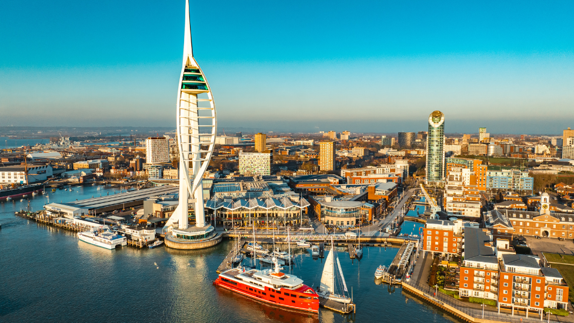
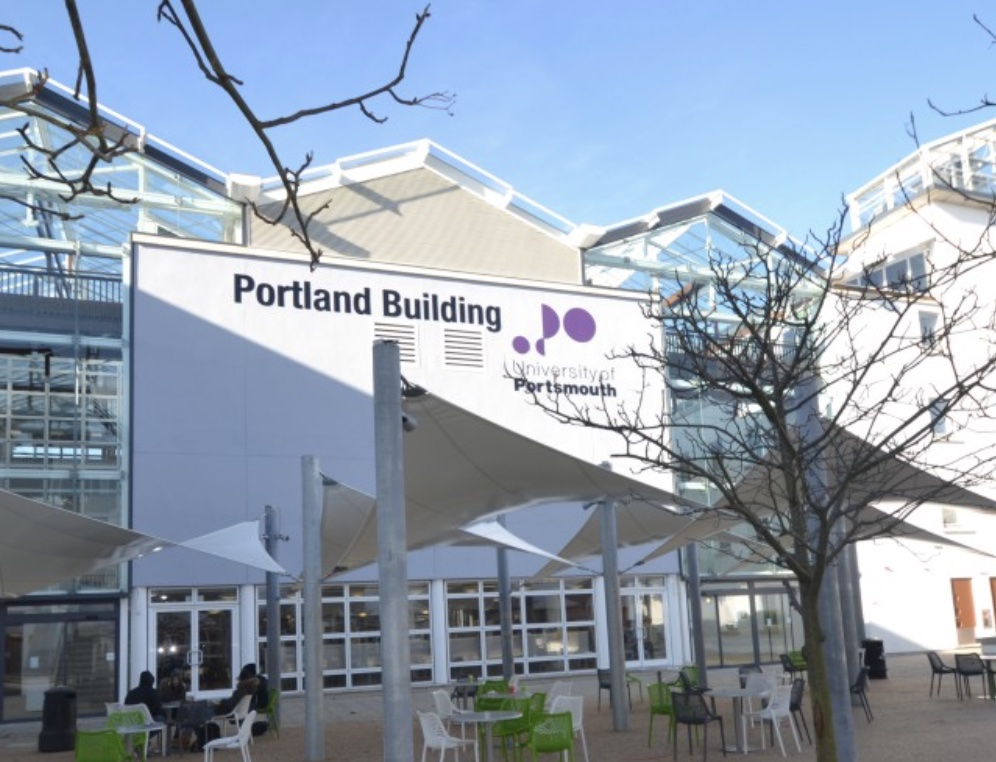
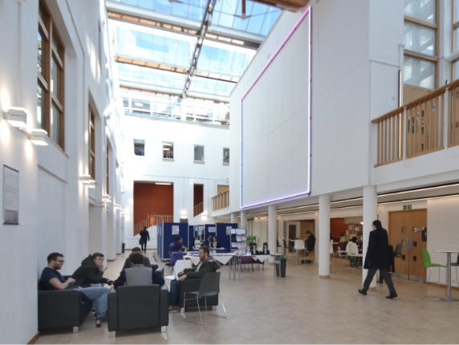

# Our Conference Location: Portsmouth

  The Spring 2027 ASAB Conference will be taking place in our historic port in the south of England.

## Conference Venues

  

    <figure class="post-card__thumb">
      
    </figure>

    

      

        <h2>Lectures & Breakouts</h2>
      

      
All talks are due to be held in the University of Portsmouth's Portland Building. Plenary lectures and oral presentations shall take place across Rooms PO 1.74, 0.28, 0.41, 1.44, 1.51, 1.66 and 1.67. Room locations are to be announced in the full programme.

    

  

    <figure class="post-card__thumb">
      
    </figure>

    

      

        <h2>Poster Area</h2>
      

      
The poster session shall take place in the atrium of the Portland Building. More information about when presenters can set up their posters shall be provided closer to the time.

    

  

    <figure class="post-card__thumb">
      
    </figure>

    

      

        <h2>Social Evening</h2>
      

      

   <a href="https://www.southseabeachcafe.co.uk/" target="_blank" rel="noopener noreferrer">Southsea Beach Café:</a> Join us on Thursday 8th April for an evening of fun! With capacity for 150 students, come and dance the night away by the sea with a buffet-style meal provided for all.
  Submit song requests using the link below – bonus points if it links to your research!
    
  <a href="https://heardthebeat.co.uk/university-of-portsmouth-08-04-26/" target="_blank">
    Submit your song requests here!!
  </a>

      
      

    

  

<h2 style="margin-top: 50px;">What to see</h2>
<ul>
  <li>
    <strong>Spinnaker Tower:</strong> A 170-metre landmark offering panoramic views across Portsmouth Harbour and the Solent River. Visit the Sky Bar for cocktails at sunset!
  </li>
    <li>
    <strong>Gunwarf Quays:</strong> A premium waterfront outlet in Portsmouth featuring over 90 designer stores, 30 international restaurants, and the iconic Spinnaker Tower.
  </li>
  <li>
    <strong>Portsmouth Historic Dockyard:</strong> Home to historic ships, museums and naval exhibitions.
  </li>
  <li>
    <strong>Southsea:</strong> A lively seafront area with beaches, cafés and views across to the Isle of Wight.
  </li>
</ul>

## How to get there
<ul>
  <li>
    <strong>Airports:</strong> Southampton Airport is the closest to the city, whereas London Gatwick and London Heathrow offer great international travel options.
  </li>
  <li>
    <strong>Train:</strong> Gatwick Airport offers a direct hourly Southern or Thameslink train service to Portsmouth & Southsea, taking approximately 1 hour and 30 minutes. South Western Railways offers a direct service from Waterloo.
  </li>
    <li>
    <strong>Driving:</strong> For convenient and central campus parking, use the Isambard Kingdom Brunel multi-storey car park. Gunwarf Quays also offers a discounted rate for students and staff commuting to Portsmouth.
  </li>
  <li>
    <strong>Hovercraft:</strong> 10 minutes from the Isle of Wight!
  </li>
</ul>

## Where to Eat and Drink 
<ul>
    <li>
      <strong><a href="https://www.gunwharf-quays.com/en" target="_blank" rel="noopener noreferrer">Gunwarf Quays</a>:</strong> A range of resturants available, with outdoor seating overlooking the marina.
  </li>
  <li>
    <strong><a href="https://www.visitportsmouth.co.uk/listing/outside-in-food-court/173627101/" target="_blank" rel="noopener noreferrer">Outside-In</a>:</strong> A warehouse-style venue featuring a range of independent street food traders and bars.
  </li>
  <li>
    <strong><a href="https://www.viet-quan.co.uk/" target="_blank" rel="noopener noreferrer">Viet Quan</a>:</strong> Vietnamese street food - a CCEP favourite!
  </li>
  <li>
    <strong><a href="https://www.nattysjerk.com/" target="_blank" rel="noopener noreferrer">Natty's Jerk</a>:</strong> A Caribbean culinary experience - another CCEP favourite!
  </li>
</ul>

## Where to stay 
<ul>
    <li>
    <strong>AirBnB:</strong> Browse to find a range of self-catering options available.
  </li>
  <li>
    <strong>Hotels:</strong> <a href="[(https://www.port.ac.uk/collaborate/business/business-services/accommodation)](https://www.guestreservations.com/ibis-portsmouth-centre/booking?utm_source=google&utm_medium=cpc&utm_campaign=23768521677&gad_source=1&gad_campaignid=23768521677&gbraid=0AAAAADiMQMZFgkUYWTorQDIJsr6D3FmMA&gclid=Cj0KCQiAzeXXBhCGARIsADO5-zHnW0akONCdOTeekMqJuvbOyu5xrJNfs7TGX78QftIuDLmf-My_5scaAgswEALw_wcB&ctTriggered=true)" target="_blank" rel="noopener noreferrer">The Ibis</a>, <a href="https://www.guestreservations.com/holiday-inn-portsmouth-portsmouth/booking?utm_source=google&utm_medium=cpc&utm_campaign=991006015&gad_source=1&gad_campaignid=991006015&gbraid=0AAAAADiMQMZ_vY6mk3RCHsMkvETswpOaF&gclid=Cj0KCQiAzeXXBhCGARIsADO5-zGfY4quT-euq5gAfUOzNmo8l-cIVNlL258ZxEkV8M_qhTwl_zrFCB0aApkmEALw_wcB" target="_blank" rel="noopener noreferrer">the Holiday Inn</a>, and <a href="https://www.premierinn.com/gb/en/hotels/england/hampshire/portsmouth/portsmouth-city-centre.html?cid=KNC_G_Hotel:UKC_User:UKC_Lang:EN_Cat:BRD-DestinationT2|Portsmouth&adgroupID=175429990511&keyword=premier%20inn%20portsmouth&matchtype=e&gad_source=1&gad_campaignid=22055909009&gclid=Cj0KCQiAzeXXBhCGARIsADO5-zHK5fLq2xOO9LEDQ3SScMbW9VC7nzRveeX0E8NDAW_NLn8Yc_w5h08aAhjmEALw_wcB&BRAND=PI" target="_blank" rel="noopener noreferrer">Premier Inn</a> are all within 5-20 minutes walk of the University.
  </li>
  <li>
<strong>University of Portsmouth accommodation:</strong> <a href="https://www.port.ac.uk/collaborate/business/business-services/accommodation">Click the link to explore University-based accommodation options!</a> Contact David Goodwin or Reservations Portsmouth for their rates of single and double en suite accommodation, including breakfast. 
    </li>
</ul>

